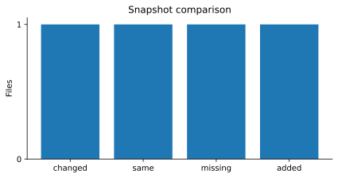

# File integrity manifests

Check a directory snapshot against a previously recorded SHA-256 manifest.

Hash files in chunks and compare by relative name. Distinguish content changes from additions and removals. The expected manifest must come from a trusted source.

[Worked notebook](file_integrity_manifests.ipynb) · [Python script](file_integrity_manifests.py)

## Run the local experiment

All records used below belong to the small fixture supplied by the example.

## Recorded output

```text
{'guide': 'changed', 'index': 'same', 'notes': 'missing', 'table': 'added'}
```

## Interpreting the result

A digest mismatch identifies changed bytes. It cannot explain when or why the file changed.



## Exercise

Hash the same directory after renaming a file and trace the manifest difference.

## References

[Python, hashlib](https://docs.python.org/3/library/hashlib.html)

[NIST Cybersecurity Framework 2.0](https://doi.org/10.6028/NIST.CSWP.29)
