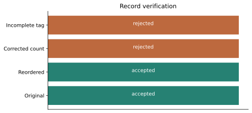

# Authenticated records with HMAC

Verify the origin and integrity of a small record shared by two trusted components.

Use a random secret and a fixed byte serialisation. Authenticate the record with HMAC-SHA-256 and verify with compare_digest. A verifier with the secret can also produce tags. Replays require separate handling.

[Worked notebook](authenticated_records_with_hmac.ipynb) · [Python script](authenticated_records_with_hmac.py)

## Run the local experiment

All records used below belong to the small fixture supplied by the example.

## Recorded output

```text
{'Original': True, 'Reordered': True, 'Corrected count': False, 'Incomplete tag': False}
```

## Interpreting the result

The reordered mapping verifies because this fixture signs canonical field order. Cross-language deployments need an agreed serialisation specification.



## Exercise

Include a sequence number in the signed bytes and describe the state a receiver must keep to detect reuse.

## References

[RFC 2104, HMAC](https://www.rfc-editor.org/rfc/rfc2104)

[Python, HMAC and constant-time comparison](https://docs.python.org/3/library/hmac.html)
