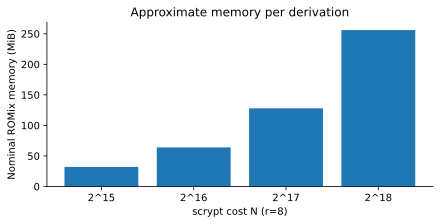

# Salted password verifiers

Create and verify independent salted records for a single demonstration passphrase held only in memory.

A verifier stores a salt, cost parameters and a slow derived value. This example uses the OWASP scrypt configuration N = 2¹⁷, r = 8 and p = 1. Verification recomputes the derivation with the stored parameters and compares fixed-length bytes.

[Worked notebook](salted_password_verifiers.ipynb) · [Python script](salted_password_verifiers.py)

## Run the local experiment

All records used below belong to the small fixture supplied by the example.

## Recorded output

```text
same record / different salt / different value [True, False, False]
```

## Interpreting the result

The memory bars use 128 × N × r bytes for the main working array. Actual process memory includes implementation overhead.



## Exercise

Determine a memory budget for two independent verifications at the demonstrated cost.

## References

[OWASP, Password Storage Cheat Sheet](https://cheatsheetseries.owasp.org/cheatsheets/Password_Storage_Cheat_Sheet.html)

[Python, hashlib](https://docs.python.org/3/library/hashlib.html)
