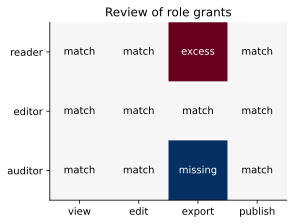

# Role-based access reviews

Compare an application permission matrix with a least-privilege baseline.

Start from an explicit set of allowed role-action pairs. Unlisted combinations are denied. Comparing an observed configuration with this policy reveals excess grants and missing grants separately.

[Worked notebook](role_based_access_reviews.ipynb) · [Python script](role_based_access_reviews.py)

## Run the local experiment

All records used below belong to the small fixture supplied by the example.

## Recorded output

```text
reader export excess
auditor export missing
```

## Interpreting the result

An approval decision still depends on the resource and request context. Role summaries can hide object-level restrictions.



## Exercise

Add an intern role with one permitted action and construct a test for an unlisted action.

## References

[OWASP, Authorization Cheat Sheet](https://cheatsheetseries.owasp.org/cheatsheets/Authorization_Cheat_Sheet.html)
