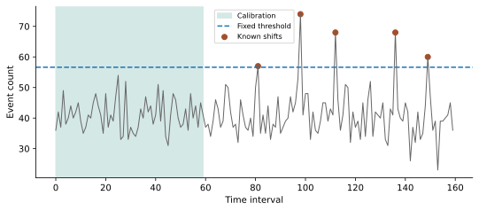

# Monitoring event-volume shifts

Detect unusual volumes in a synthetic operational event series and measure false alerts.

Estimate the normal volume and spread using an initial calibration period. Freeze the threshold, then score a later interval with known shifts. Keep chronology intact so the injected events cannot influence the baseline.

[Worked notebook](monitoring_event_volume_shifts.ipynb) · [Python script](monitoring_event_volume_shifts.py)

## Run the local experiment

All records used below belong to the small fixture supplied by the example.

## Recorded output

```text
TP 5 FP 0 FN 0 TN 95
precision / recall / average precision [1. 1. 1.]
```

## Interpreting the result

Detection quality depends on the calibration period and the magnitude of each shift. The labels describe event volume, not an incident cause.



## Exercise

Double the baseline volume after the calibration period and measure the false-alert burden.

## References

[NIST SP 800-92, computer security log management](https://doi.org/10.6028/NIST.SP.800-92)

[OWASP, Logging Cheat Sheet](https://cheatsheetseries.owasp.org/cheatsheets/Logging_Cheat_Sheet.html)
