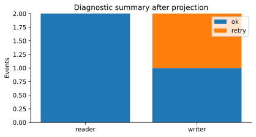

# Privacy-preserving event summaries

Produce a diagnostic summary from an allowlist of fields.

Use a small schema that emits only fields needed for aggregate error counts. Reconstruct a new record rather than recursively copying unknown context. A count can still reveal information about a very small population.

[Worked notebook](privacy_preserving_event_summaries.ipynb) · [Python script](privacy_preserving_event_summaries.py)

## Run the local experiment

All records used below belong to the small fixture supplied by the example.

## Recorded output

```text
aggregate counts [(('reader', 'ok'), 2), (('writer', 'ok'), 1), (('writer', 'retry'), 1)]
```

## Interpreting the result

The output preserves the fields needed for this count. Free text and nested metadata have no route into the exported records.



## Exercise

Add an unknown component and specify how rejected schema values should be counted without exposing the original record.

## References

[OWASP, Logging Cheat Sheet](https://cheatsheetseries.owasp.org/cheatsheets/Logging_Cheat_Sheet.html)
