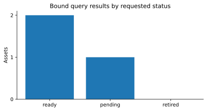

# Parameterised SQLite reads

Retrieve approved local inventory rows with bound query parameters.

Use a fixed SELECT statement with placeholders for the requested status. Turn on SQLite query_only after initialisation and test a value containing an apostrophe as ordinary data. Return just the fields required for the report.

[Worked notebook](parameterised_sqlite_reads.ipynb) · [Python script](parameterised_sqlite_reads.py)

## Run the local experiment

All records used below belong to the small fixture supplied by the example.

## Recorded output

```text
row counts {'ready': 2, 'pending': 1, 'retired': 0}
```

## Interpreting the result

An unknown status returns an empty result. Binding applies to values. A query builder that chooses column names needs a separate allowlist of identifiers.



## Exercise

Add a second bound condition and check a name with a space.

## References

[Python, sqlite3 parameter substitution](https://docs.python.org/3/library/sqlite3.html)
