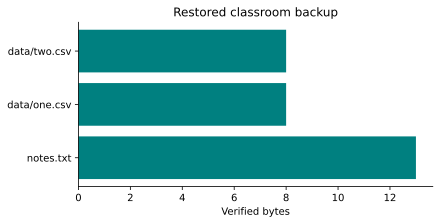

# Testing a backup restore

Measure whether a local restore reproduces every expected object.

Create a small snapshot with a trusted manifest, restore into an empty temporary directory and independently hash the restored files. Count missing, incorrect and verified objects. A successful backup job and a verified restore answer different operational questions.

[Worked notebook](testing_a_backup_restore.ipynb) · [Python script](testing_a_backup_restore.py)

## Run the local experiment

All records used below belong to the small fixture supplied by the example.

## Recorded output

```text
verified objects 3 of 3
verified bytes 29
```

## Interpreting the result

A byte-perfect restore checks integrity for this snapshot. Application consistency and restore time require separate tests on a representative workload.



## Exercise

Exclude one expected item from the restore and add an explicit missing-object outcome.

## References

[NIST Cybersecurity Framework 2.0](https://doi.org/10.6028/NIST.CSWP.29)

[Python, hashlib](https://docs.python.org/3/library/hashlib.html)
