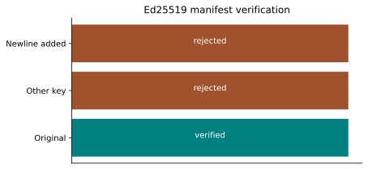

# Verifying signed release artefacts

Use a public key to verify a release manifest and report which objects match it.

An Ed25519 signer signs exact manifest bytes. A consumer verifies the signature using an independently trusted public key before relying on the manifest hashes. This example generates a demonstration key in memory.

[Worked notebook](verifying_signed_release_artefacts.ipynb) · [Python script](verifying_signed_release_artefacts.py)

## Run the local experiment

All records used below belong to the small fixture supplied by the example.

## Recorded output

```text
signature checks {'Original': True, 'Other key': False, 'Newline added': False}
matching files 2
```

## Interpreting the result

The public key must be provisioned through a trusted route. A different serialisation changes the signed message even when the decoded fields look similar.



## Exercise

Sign a second version and verify that each signature matches only its own manifest.

## References

[RFC 8032, Edwards-curve digital signature algorithm](https://www.rfc-editor.org/rfc/rfc8032)

[Cryptography, Ed25519 signatures](https://cryptography.io/en/latest/hazmat/primitives/asymmetric/ed25519/)
