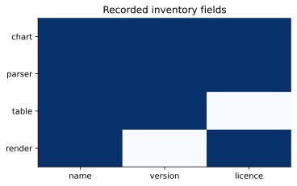

# Software inventory coverage

Audit a small bill of materials for missing package metadata.

A component inventory supports dependency review. Measure coverage separately for name, version and licence. A licence string merely records a declaration, so provenance and legal review remain distinct from field completeness.

[Worked notebook](software_inventory_coverage.ipynb) · [Python script](software_inventory_coverage.py)

## Run the local experiment

All records used below belong to the small fixture supplied by the example.

## Recorded output

```text
field coverage {'name': np.float64(1.0), 'version': np.float64(0.75), 'licence': np.float64(0.75)}
complete records 2 of 4
```

## Interpreting the result

The matrix shows field presence in a teaching fixture. Full CycloneDX validation requires the selected schema version and its component structure.



## Exercise

Add an explicit source field and recompute the proportion of complete records.

## References

[CycloneDX, specification overview](https://cyclonedx.org/specification/overview/)

[NIST Cybersecurity Framework 2.0](https://doi.org/10.6028/NIST.CSWP.29)
